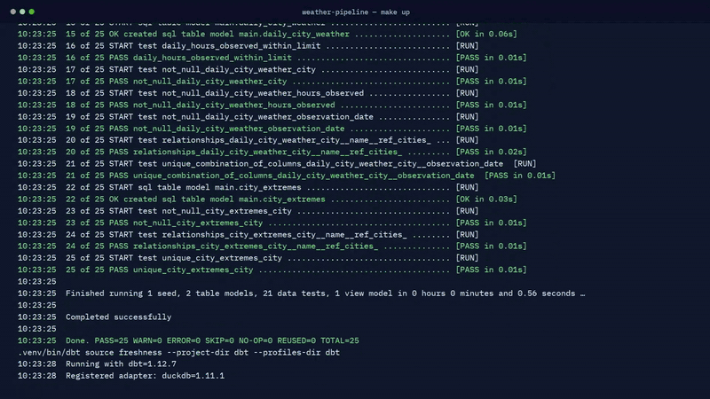

# data-pipeline-template

**Start a client data project in a day:** ingestion, dbt models and tests, CI, Docker and
optional Airflow, generated with one [Copier](https://copier.readthedocs.io/) command.

[](https://willowvibe.github.io/data-pipeline-template/#demo)

Full 91-second demo with voiceover: [willowvibe.github.io/data-pipeline-template](https://willowvibe.github.io/data-pipeline-template/#demo)

The template generates a small but complete weather pipeline. It fetches hourly weather for
three cities from [Open-Meteo](https://open-meteo.com/), keeps the raw JSON for replay, loads
it into DuckDB or Postgres, and models it with dbt into daily summaries and city extremes.
Everything is wired to run locally and in CI on day one.

## What you get

- **Two warehouses** — DuckDB for a zero-infrastructure local start, or Postgres 16 in
  Docker Compose.
- **Optional orchestration** — plain CLI and Makefile, or Airflow 3.4 with
  [astronomer-cosmos](https://github.com/astronomer/astronomer-cosmos) so every dbt model
  is its own task.
- **Idempotent ingestion** — raw responses are validated, written one file per city per UTC
  date, and loaded with delete-then-insert in one transaction.
- **dbt with tests and source freshness** — typed staging, documented marts, grain tests,
  accepted ranges, relationship tests and a singular test.
- **Quality gates** — ruff, sqlfluff, pre-commit, pytest (offline by default) and a
  generated GitHub Actions workflow.
- **A real offline path** — a recorded Open-Meteo fixture is re-dated to today so tests,
  `make ci` and demos never depend on the network.

All four combinations (`duckdb | postgres` × `none | airflow`) are rendered and exercised by
the template's CI. In local verification `make up` brought the Airflow stack up and the DAG
run completed all of its tasks.

## Quickstart

Requires Python 3.12, `pipx`, and Docker when you choose Postgres or Airflow.

```bash
pipx install copier
copier copy gh:willowvibe/data-pipeline-template my-pipeline
cd my-pipeline && make install && make up
```

`make up` extracts the forecast window, loads it, builds the dbt models and runs their
tests. For `warehouse=postgres` it starts the `warehouse-db` container first; for
`orchestrator=airflow` it builds the Airflow image, waits for the apiserver, and triggers
`weather_pipeline`. The Airflow UI is at <http://localhost:8080> (default login
`airflow` / `airflow`).

To try the pipeline without Docker or an API call:

```bash
copier copy gh:willowvibe/data-pipeline-template my-pipeline --defaults
cd my-pipeline && make install && PIPELINE_OFFLINE=1 make run build
```

## Options

| Key | Type / choices | Default | Notes |
|---|---|---|---|
| `project_name` | string | `weather-pipeline` | Lowercase letters, digits and hyphens. |
| `package_name` | computed string | `weather_pipeline` | `project_name` with `-` → `_`; Python package and dbt project. |
| `warehouse` | `duckdb` \| `postgres` | `duckdb` | Postgres runs in Docker Compose on `WAREHOUSE_PORT` (default 5436). |
| `orchestrator` | `none` \| `airflow` | `none` | Airflow adds the image, Compose services and the Cosmos DAG. |
| `cities` | YAML list of `{name, latitude, longitude}` | Bengaluru, London, New York | Drives extraction, the raw folders and the dbt `cities` seed. |
| `python_version` | `3.12` | `3.12` | A choice so newer versions can be added later. |
| `author_name` | string | `WillowVibe` | Used in `pyproject.toml` and the generated README. |

No `_tasks` are defined, so generation does not execute code and Copier does not need
`--trust`.

## Generated project

```text
<project_name>/
├── README.md
├── Makefile                     # install, run, backfill, build, test, lint, ci, up, down, clean
├── pyproject.toml               # deps chosen for the warehouse; [airflow] adds Cosmos
├── .copier-answers.yml          # enables `copier update`
├── .env.example                 # [postgres] connection vars; [airflow] Airflow settings
├── .pre-commit-config.yaml
├── .sqlfluff
├── .github/workflows/ci.yml
├── docker-compose.yml           # [postgres] warehouse; [airflow] Airflow stack
├── airflow/                     # [airflow]
│   ├── Dockerfile
│   └── dags/weather_pipeline.py
├── src/<package_name>/
│   ├── config.py
│   ├── extract.py
│   ├── load.py
│   ├── warehouse.py
│   ├── cli.py
│   └── __main__.py
├── dbt/
│   ├── dbt_project.yml
│   ├── profiles.yml
│   ├── seeds/cities.csv
│   ├── models/sources.yml
│   ├── models/staging/stg_hourly_weather.sql
│   ├── models/marts/daily_city_weather.sql
│   ├── models/marts/city_extremes.sql
│   └── tests/
├── tests/
│   ├── fixtures/open_meteo_sample.json
│   ├── test_extract.py
│   ├── test_load.py
│   ├── test_cli.py
│   └── test_dag.py              # [airflow]
├── data/.gitkeep
└── docs/ARCHITECTURE.md
```

The data flow is:

```text
Open-Meteo ──extract──▶ data/raw/<city>/<date>.json ──load──▶ raw.hourly_weather
                                          dbt seed cities ──┐        │
                                    stg_hourly_weather ◀────────────┘
                                                │
                           daily_city_weather · city_extremes
```

## What CI proves

`.github/workflows/ci.yml` in this repository has three jobs:

- **`render-tests`** renders all four combinations with pytest-copie and checks the shape:
  conditional files exist only for the chosen options, the dbt profile matches the
  warehouse, the generated workflow parses, and no `{{` / `{%` is left behind.
- **`projects`** runs `bash scripts/check.sh <warehouse> <orchestrator>` for each of the four
  combinations. Each leg renders a fresh project, creates a Python 3.12 virtualenv,
  installs it, and runs the generated `make ci`. That means ruff, sqlfluff, pytest in
  offline mode, an offline extract + load, `dbt seed`, `dbt build` and
  `dbt source freshness`.

Postgres legs use a `postgres:16` service container and pass `WAREHOUSE_HOST=localhost`,
`WAREHOUSE_PORT=5432`. Airflow legs also run `airflow db migrate` and
`airflow dags test weather_pipeline <today>` in a temporary `AIRFLOW_HOME`, so the DAG and
its Cosmos tasks execute without a webserver. CI installs Airflow without the official
constraints file because it conflicts with the pinned `duckdb` and `tenacity` versions.

- **`airflow-stack`** renders the `airflow` orchestrator with both warehouses (`duckdb` and
  `postgres`), runs the generated `make up` against a real Docker Compose stack (scheduler,
  apiserver and dag-processor), and waits for every `weather_pipeline` DAG run to succeed.

`.github/workflows/live-api.yml` is a separate weekly (and manually dispatchable) job that
renders `duckdb` + `none` and runs `make run build` against the real Open-Meteo API. It is
deliberately not required for pull requests.

## Keeping generated projects up to date

Every generated project records its answers in `.copier-answers.yml`. To pull in template
fixes and new options:

```bash
cd my-pipeline
copier update --defaults
```

Copier performs a three-way merge against your git state. `tests/test_update.py` proves this
works from the newest tag once a tag exists; before the first tag the test skips with a
reason. Because the template has no generation tasks, `--trust` is not needed.

## How we'd adapt this for your business

The weather source is intentionally thin, and the boundaries are the point:

- **Your source** — replace `fetch_city` and `validate_payload` in `extract.py`, and adjust
  `write_raw` so one file still represents one entity and one UTC date. Keep the raw copy.
- **Your table** — update the raw schema in `warehouse.py` and the row mapping in
  `load.py`. The placeholder abstraction (`?` for DuckDB, `%s` for psycopg) keeps one load
  implementation.
- **Your models** — replace the staging model and marts; keep the grain tests, accepted
  ranges and source freshness.
- **Your infrastructure** — add a warehouse branch to the template's `warehouse` choices,
  a dbt target, and any required Compose services. The generated project tree stays the
  same.
- **Your orchestration** — the Airflow DAG calls the same `extract_all` / `load_all`
  functions as the CLI, so swapping the scheduler does not fork the business logic.

If you want the pipeline wired to your own API, warehouse or orchestrator, this is the
starting point rather than a throwaway demo.

## Repository layout

```text
data-pipeline-template/
├── copier.yml
├── template/                    # the rendered tree (Jinja and conditional file names)
├── scripts/render.sh            # render one combination non-interactively
├── scripts/check.sh             # render, install and run the generated project's make ci
├── scripts/build_site.sh        # build the GitHub Pages site from a generated project
├── tests/test_render.py         # shape tests for all four combinations
├── tests/test_update.py         # `copier update` from the newest tag
├── site/index.html              # static Pages landing page
├── docs/design.md               # the approved design and pinned versions
├── .github/workflows/           # template CI, weekly live API job, Pages deploy
├── README.md
├── CHANGELOG.md
└── LICENSE
```

## Credits

- The Airflow Compose services are adapted from the official Apache Airflow
  docker-compose file (Apache-2.0).
- The service layout follows
  [cnstlungu/portable-data-stack-airflow](https://github.com/cnstlungu/portable-data-stack-airflow)
  (MIT).
- dbt orchestration uses [astronomer-cosmos](https://github.com/astronomer/astronomer-cosmos)
  (Apache-2.0).
- Sample data comes from [Open-Meteo](https://open-meteo.com/). It is free for
  non-commercial use; client or commercial deployments should use their own source or
  Open-Meteo's commercial plan.

## License

MIT © WillowVibe. See [LICENSE](LICENSE).
